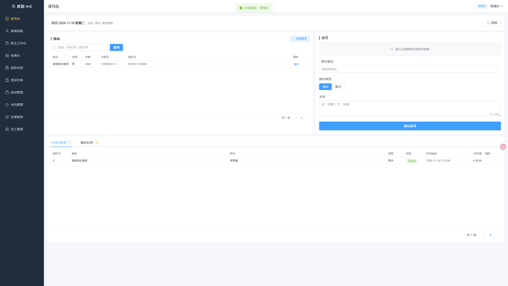
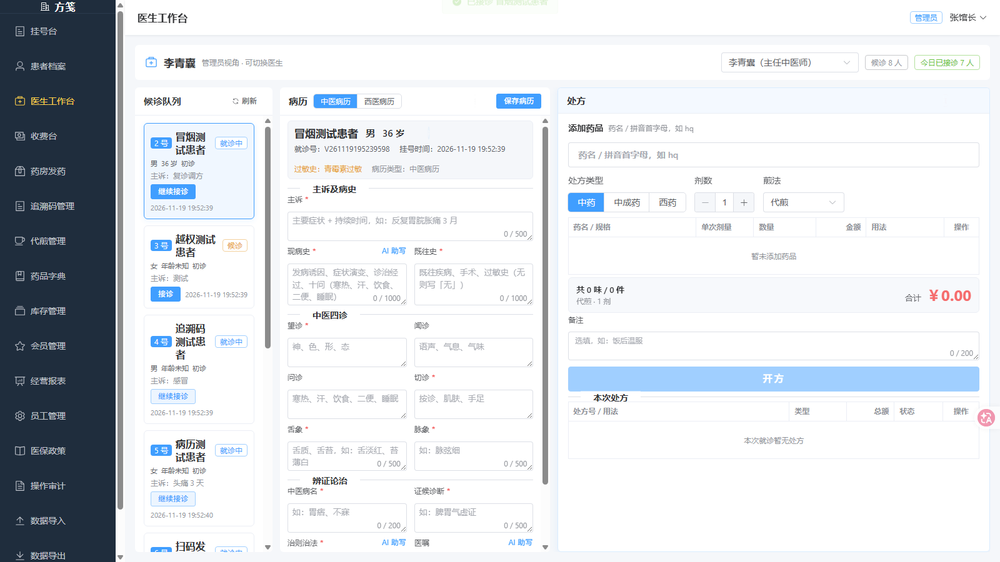
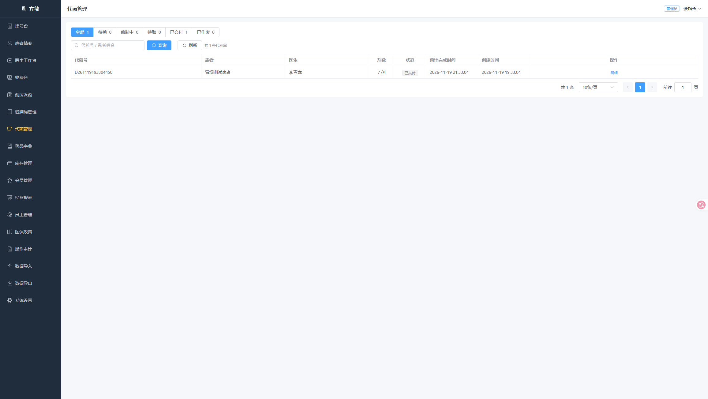
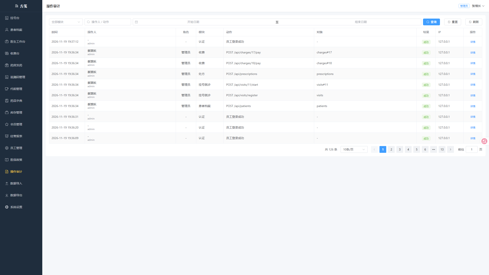

# 方笺 · 开源中医馆信息管理系统

[](https://github.com/othellllo/fangjian-clinic/actions/workflows/ci.yml)
[](LICENSE)
[](https://github.com/othellllo/fangjian-clinic/releases)
[](scripts/README.md)

> 仓库：<https://github.com/othellllo/fangjian-clinic> · 便携版下载：[Releases](https://github.com/othellllo/fangjian-clinic/releases)

面向**中医馆 / 医馆 / 小型诊所**的开源信息管理系统，覆盖「挂号 → 候诊 → 接诊 → 开方 → 收费 → 发药 → 报表」的完整门诊闭环，并按中医业务特点设计病历（四诊、辨证、治则）与饮片库存（批号、效期、先进先出）。

参考产品：ABC 诊所管家（学习其业务流程与信息结构，代码为独立实现）。

## 功能范围（第一版）

| 模块 | 说明 |
| --- | --- |
| 挂号台 | 患者建档、选医生挂号、排队号生成、挂号费收费单、今日挂号与候诊队列、**今日预约到店报到** |
| 医生工作台 | 候诊队列、接诊、**中医/西医病历分开**（必填校验 + 焦点即出常见项 + 实时质控 + AI 助写）、**开方区占主导 + 药品首拼模糊搜索 + 键盘流录方 + 途径/频次结构化用法**、完成就诊 |
| **用药安全** | 开方自动审查十八反/十九畏、妊娠禁忌、毒性药、剂量范围；**特殊煎法自动标注**（先煎/后下/包煎/另煎/烊化/冲服） |
| 收费台 | 待收费列表、收费（现金/微信/支付宝/银行卡/会员余额/医保）、退费、日结汇总 |
| 药房 | 待发药处方、**扫码发药（扫一次扣一次库存）**、发药并扣减批次库存、库存流水、无处方直接出库 |
| **代煎管理** | 中药代煎发药后自动建单，待煎 → 煎制中 → 待取 → 已交付全流程 + 药品明细 |
| 药品与库存 | 药品字典（饮片/中成药/西药/耗材）、批号与效期、入库、盘点、低库存与临期告警 |
| 患者档案 | 患者检索、建档、就诊历史 |
| 会员 | 会员卡、储值充值、余额支付、储值流水 |
| **预约挂号** | 小程序预约选医生/选时段/号源控制，前台到店报到自动生成就诊记录 |
| 经营报表 | 日报、区间趋势、医生绩效、药品销量、**医保结算统计（笔数/医保支付/个人自付/均次费用）** |
| **药品追溯码** | 入库扫码绑定、台账、按码反查全链路、发药强制扫码核销（中成药/西药）、退药回退、上传医保平台（SPI） |
| **打印** | 收费小票（58/80mm 热敏）、处方笺（A5），后端生成打印样式 HTML，浏览器直接调起打印 |
| **管理设置** | 打印纸宽/抬头/页脚/份数、收款方式启停与排序、药品库存上下限批量设置 |
| **数据导出** | 患者/就诊/收费/处方/库存/审计/追溯码 7 类 CSV（UTF-8 BOM，Excel 直接打开），导出留痕 |
| **数据迁移** | Excel 导入：患者档案、药品字典、初始库存、历史病历；模板下载 → 校验预览 → 执行导入，失败行逐条报错 |
| **医保政策库** | 政策结构化登记（文号/生效失效日期/分类/来源链接）、到期提醒、正文留档 |
| **操作审计** | 自动记录所有写操作（谁/何时/对什么/结果/IP），登录成功失败均留痕，管理员可检索 |
| **微信小程序患者端** | 手机号登录、预约挂号、我的预约、就诊记录、病历与费用查看 |
| 医保扩展点 | `InsuranceProvider` SPI，按地区实现插件化接入 |
| 系统管理 | 员工账号与角色（管理员/医生/收费员/药师）、医馆信息 |

## 技术栈

- 后端：**Java 21 + Spring Boot 3.3 + Spring Data JPA + Spring Security(JWT) + Flyway**
- 数据库：**MySQL 8**（生产）/ **H2 MySQL 模式**（开发演示，零安装）
- 前端：**Vue 3 + Vite 5 + Element Plus + Pinia + ECharts**
- 鉴权：JWT，角色分为 `ADMIN` / `DOCTOR` / `CASHIER` / `PHARMACIST`

详细接口见 [docs/api-contract.md](docs/api-contract.md)。

## 界面预览

挂号台（患者建档 + 选医生挂号 + 今日挂号 / 候诊队列）



医生工作台（候诊 / 病历 / 开方，开方区占主导）



代煎管理（发药后自动建单，全流程可追踪）



操作审计（所有写操作留痕，可追溯到人）



其余页面截图见 [`screenshots/`](screenshots/)：登录、挂号台（含今日预约）、收费台、药房发药、经营报表、患者档案。

## 本地部署（绿色便携版，推荐给医馆装机）

面向"双击就用、不用装任何环境"的交付形态：内置精简 Java 运行环境 + 单进程（后端直接托管前端）
+ 内嵌 H2 数据库 + 启动自动备份。目标电脑**不需要装 JDK / Node / MySQL / Nginx**。

```powershell
# 一键构建（需 JDK 21；Maven 随盘在 .tools）
powershell -ExecutionPolicy Bypass -File scripts\build-portable.ps1 -Zip
```

产物：`release\方笺系统\`（约 120MB，jar 内已含前端）与同名 zip：

```
方笺系统\
├─ 启动方笺系统.bat     双击启动，浏览器自动打开 http://127.0.0.1:8080
├─ 停止方笺系统.bat     停止后台服务
├─ 打开方笺系统.bat     仅打开浏览器
├─ runtime\             jlink 裁剪的 Java 运行时（用户无需安装）
├─ app\方笺系统.jar      后端 + 前端静态资源
├─ config\              端口等配置（改完重启生效）
├─ data\                数据库（首次启动自动生成）
├─ backup\              每次启动自动整库备份，保留 7 份
├─ logs\                运行日志
└─ 使用说明.txt
```

数据与程序在一起，**整个文件夹拷走即完成迁移**。适合单机私有化：医馆一台电脑，数据不出店。

## 快速开始

环境要求：**JDK 21**、**Maven 3.9+**、**Node.js 18+**；或直接用 Docker（见文末）。

Windows 下可一条命令拉起前后端（自动定位本机 JDK/Maven）：

```powershell
powershell -ExecutionPolicy Bypass -File scripts\start-dev.ps1
```

### 1. 后端（H2 演示库，开箱即用）

```bash
cd backend
mvn spring-boot:run
# 启动后 http://localhost:8080 ，Swagger: http://localhost:8080/swagger-ui.html
```

首次启动会自动建表、写入演示药品，并创建演示账号（默认密码均为 `123456`）：

| 账号 | 角色 |
| --- | --- |
| `admin` | 管理员 |
| `doctor01` / `doctor02` / `doctor03` | 医生 |
| `cashier01` | 收费员 |
| `pharmacist01` | 药师 |

### 2. 前端

```bash
cd frontend
npm install
npm run dev
# 打开 http://localhost:5173 ，接口通过 Vite 代理到 8080
```

### 3. 微信小程序患者端

1. 微信开发者工具「导入项目」，目录选 `miniapp/`，AppID 用游客模式（工程内已配 `touristappid`，`urlCheck:false` 便于本地 http 调试）。
2. 接口地址在 `miniapp/config.js` 的 `BASE_URL`（默认 `http://localhost:8080/api`），真机调试改成电脑局域网 IP。
3. 登录：手机号必须在医馆已建档（先用员工端建一个患者），验证码开发环境固定 `123456`。
4. 详细说明见 [miniapp/README.md](miniapp/README.md)。

> 患者端与管理端使用同一套 JWT 但角色为 `PATIENT`，患者 token 无法访问员工接口。

### 4. 生产部署（MySQL 8）

```bash
# 建库
mysql -uroot -p -e "CREATE DATABASE fangjian_clinic DEFAULT CHARSET utf8mb4;"

# 启动（Flyway 自动建表）
java -jar backend/target/fangjian-clinic-0.1.0.jar \
  --spring.profiles.active=prod \
  --DB_HOST=127.0.0.1 --DB_USER=fangjian --DB_PASSWORD=yourpassword \
  --JWT_SECRET=请替换为足够长的随机字符串
```

前端 `npm run build` 后把 `frontend/dist` 交给 Nginx 托管，`/api` 反向代理到后端即可；也可直接用 `docker-compose.yml` 一键起 MySQL + 后端 + Nginx。

## 验证情况

本项目交付时已在真实环境跑通，不是「只写不跑」的代码。**八套端到端冒烟合计 106 项检查**（v1/v2 34 + v3 19 + v4 17 + v5 12 + v6 9 + v7 9 + v8 6）：

| 验证项 | 命令 | 结果 |
| --- | --- | --- |
| 后端编译 | `cd backend && mvn -DskipTests compile` | ✅ BUILD SUCCESS |
| 后端测试 | `cd backend && mvn test` | ✅ 4 个测试通过（登录、鉴权拦截、建档、上下文加载） |
| 端到端接口（v1+v2） | `node scripts/smoke.mjs` | ✅ **34 项检查通过**：门诊闭环 + 代煎流转 + 小程序预约/报到 + 患者端资料(含会员余额) + 越权拦截 + 操作审计 + 401/403 |
| 端到端接口（v3） | `node scripts/smoke-v3.mjs` | ✅ **19 项检查通过**：打印 HTML、追溯码绑定/重复拦截/未扫码禁发药/扫码核销/退药/上传桩、设置、CSV 导出带 BOM、政策库、医保统计 |
| 端到端接口（v4） | `node scripts/smoke-v4.mjs` | ✅ **17 项检查通过**：联想（关键字/拼音）、中医/西医必填质控、AI 本地助写、十八反拦截、妊娠禁用、剂量提示、先煎自动标注、病历保存类型校验、药品临床属性 |
| 端到端接口（v5） | `node scripts/smoke-v5.mjs` | ✅ **12 项检查通过**：4 类模板均为有效 xlsx、预览校验（3 行通过 2 报错 1）、重复导入跳过、药品含临床属性、库存入库写流水、病历生成历史就诊、异常行隔离 |
| 端到端接口（v6） | `node scripts/smoke-v6.mjs` | ✅ **9 项检查通过**：饮片扫码按量扣库存、扫完自动完成发药、旧整单发药被拒、需追溯品种拦截条码、追溯码逐件核销、无处方直接出库 |
| 端到端接口（v7） | `node scripts/smoke-v7.mjs` | ✅ **9 项检查通过**：拼音首字母/中文/编码搜药、联想字段完整、limit 生效、常见证型与主诉、历史高频优先 |
| 端到端接口（v8） | `node scripts/smoke-v8.mjs` | ✅ **6 项检查通过**：用法字典、途径+频次转中文拼装、自定义用法优先、煎法叠加、未知代码容错 |
| 前端生产构建 | `cd frontend && npm run build` | ✅ 15 个页面 chunk 全部产出 |
| 真实浏览器渲染 | 见 `scripts/ui-check.mjs`、`scripts/ui-check-v2.mjs` | ✅ 11 个页面无控制台报错，截图见 `screenshots/` |
| 小程序静态校验 | `node --check` + JSON 解析 + mock `wx` 运行器 | ✅ 12 个 JS / 9 个 JSON 通过；6 个页面 90/90 断言（**无微信开发者工具，未做真机编译**） |
| 绿色便携版 | 解压 zip → 双击启动 → 全流程 | ✅ 内置 runtime 启动、单端口托管前端、SPA 深链接回落、34 项冒烟通过、停止脚本生效、无 ERROR 日志 |

> Windows 环境下如果 `npm run build` 报 esbuild `Access is denied`，属本机安全策略问题，
> 见 [scripts/README.md](scripts/README.md) 的绕过方法。

## 生产部署与备份

单机私有化部署（MySQL 8 + jar + Nginx）、systemd 托管、每日备份与恢复演练、
上线安全检查清单，见 **[docs/deploy.md](docs/deploy.md)**。

```powershell
# 每日备份（保留 30 天）
powershell -File scripts\backup-mysql.ps1 -Password '库密码' -OutDir D:\his-backup -KeepDays 30
# 恢复
powershell -File scripts\restore-mysql.ps1 -File D:\his-backup\fangjian_clinic-20261118-020000.sql.gz -Password '库密码'
```

## 目录结构

```
fangjian-clinic/
├─ backend/                     Spring Boot 单体（按领域分包，不拆微服务）
│  └─ src/main/java/com/fangjian/his/
│     ├─ common/                统一响应、分页、异常、单号生成
│     ├─ config/                安全配置、JWT、Jackson、审计过滤器、启动初始化
│     ├─ domain/                实体与枚举
│     ├─ repository/            Spring Data JPA 仓储
│     ├─ service/               业务逻辑
│     ├─ controller/            REST 接口（含 /api/patient 患者端）
│     ├─ dto/                   视图对象
│     └─ integration/           医保 SPI 扩展点
│  └─ src/main/resources/db/migration/   Flyway 迁移脚本 V1~V3
├─ frontend/                    Vue 3 + Element Plus（15 个页面）
├─ miniapp/                     微信小程序患者端（原生 WXML/WXSS/JS）
├─ docs/                        接口契约、设计说明、临床设计、政策调研、生产部署手册
├─ scripts/                     冒烟测试、UI 检查、MySQL 备份/恢复、一键启动、便携版打包
├─ screenshots/                 实际运行截图
├─ release/                     便携版构建产物（build-portable.ps1 生成，git 忽略）
├─ docker-compose.yml           MySQL + 后端 + Nginx 一键部署
└─ .env.example                 compose 环境变量示例
```

## 关键设计说明

- **金额**：数据库 `DECIMAL(12,2)`，Java `BigDecimal`，不使用浮点。
- **库存**：结存以批次 `drug_batch.quantity` 为准，任何变动都写 `stock_ledger` 流水，发药按效期先进先出（FEFO）跨批次扣减。
- **病历**：一诊一档，带 `version` 版本号，每次保存递增，便于追溯；作废就诊不可书写病历。
- **收费与处方解耦**：开方即生成收费单，收费后才允许发药，避免漏费。
- **单机私有化**：默认 H2 文件库可直接单机运行；生产切 MySQL，数据不出店。

## 路线图

已完成（v1 + v2 + v3）：

- [x] 门诊闭环：挂号 → 候诊 → 接诊 → 病历 → 开方 → 收费 → 发药
- [x] 中医病历（四诊 / 舌脉 / 辨证 / 治则 / 版本化）
- [x] 饮片批次库存与效期先进先出、库存流水
- [x] 会员储值与余额支付
- [x] 经营报表（日报 / 区间 / 医生绩效 / 药品销量 / 医保结算统计）
- [x] 操作审计日志（写操作自动记录）
- [x] 中药代煎流程
- [x] 微信小程序患者端（预约 / 就诊记录）
- [x] MySQL 生产部署与备份恢复
- [x] 绿色便携版本地部署（内置运行时、单进程、自动备份）
- [x] 小票 / 处方笺打印
- [x] 药品追溯码（入库绑定、发药强制扫码、退药回退、上传扩展点）
- [x] 管理设置（打印、收款方式、药品库存上下限）
- [x] 数据导出（7 类 CSV）
- [x] 医保政策库与到期提醒
- [x] 中医 / 西医病历分开，按《中医病历书写基本规范》做必填与质控
- [x] 病历联想输入（标准术语库 + 本院历史病历 + 拼音码）
- [x] AI 助写（默认离线模板，可选接内网 OpenAI 兼容模型，草稿需人工确认）
- [x] 用药安全审查（十八反/十九畏/妊娠禁忌/毒性/剂量）
- [x] 特殊煎法自动标注（先煎/后下/包煎/另煎/烊化/冲服）
- [x] Excel 数据迁移（患者档案 / 药品字典 / 初始库存 / 历史病历，带预览校验）
- [x] 扫码发药（扫一次扣一次库存，扫完自动完成）+ 无处方直接出库

尚未实现：

- [ ] 多租户（SaaS）支持：业务表增加 `tenant_id` + 数据权限拦截器
- [ ] 短信服务商接入（患者端验证码目前为固定码 `123456`）
- [ ] 病历历史版本快照（当前仅 `version` 递增，无历史内容留档）
- [ ] 医保接口地区实现（上海、浙江等），目前仅有 SPI 与桩实现
- [ ] 药品追溯码上传真实平台（现有 SPI 与本地待补传台账）
- [ ] 收费小票套打（财政/税务监制票据、票号管理）
- [ ] 微信支付（小程序内在线支付）
- [ ] 库存盘点单与出入库单据打印

## 参与贡献

欢迎 Issue 与 PR。开始之前请阅读：

- [贡献指南](CONTRIBUTING.md)：开发环境、代码结构、提交规范、自检清单
- [行为准则](CODE_OF_CONDUCT.md)
- [安全策略](SECURITY.md)：漏洞报告方式与部署安全清单
- [更新日志](CHANGELOG.md)

推送或提交 PR 后，GitHub Actions 会自动执行后端测试与前端构建（见 `.github/workflows/ci.yml`）。

**医疗合规声明**：本项目是信息管理工具，不构成诊疗建议，也不替代医师判断；
用药安全提示与病历质控仅作辅助，最终由执业医师负责。

## 文档索引

| 文档 | 内容 |
| --- | --- |
| [docs/api-contract.md](docs/api-contract.md) | 前后端接口契约（v1~v6 全部接口） |
| [docs/naming.md](docs/naming.md) | 项目命名理由、标识对照表与商标提醒 |
| [docs/open-core.md](docs/open-core.md) | 开源版与商业版分层方案（open-core） |
| [docs/publishing.md](docs/publishing.md) | 推 GitHub、发 Release、仓库设置 |
| [docs/design.md](docs/design.md) | 领域模型、业务规则与设计取舍 |
| [docs/clinical-design.md](docs/clinical-design.md) | 病历书写规范依据、质控规则、用药安全规则、AI 方案 |
| [docs/policy-brief.md](docs/policy-brief.md) | 医保政策与追溯码合规调研（含官方链接） |
| [docs/deploy.md](docs/deploy.md) | MySQL 生产部署、systemd、备份恢复、上线安全清单 |
| [docs/portable-deployment.md](docs/portable-deployment.md) | 绿色便携版构建与本地部署 |
| [docs/third-party.md](docs/third-party.md) | 第三方依赖与许可证 |
| [docs/next-steps.md](docs/next-steps.md) | 待办与已知缺口 |

## 许可证

本项目以 **Apache License 2.0** 发布，见 [LICENSE](LICENSE)。

你可以自由商用、修改、再分发，但需保留版权与许可声明；本项目不提供任何担保。
第三方依赖的许可情况见 [docs/third-party.md](docs/third-party.md)。
